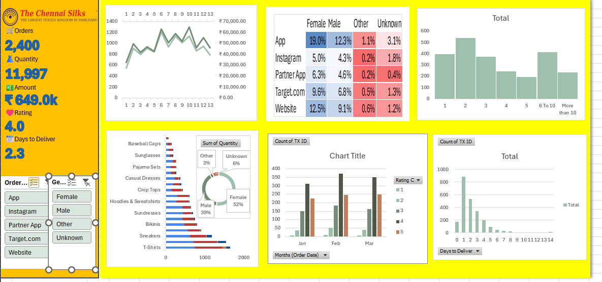

# Chennai Silks E-commerce Sales Dashboard

## Project Overview

This project presents an interactive e-commerce sales dashboard developed using Microsoft Excel. The dashboard provides a visual overview of sales performance, product quantities, customer ratings, and delivery trends using the project dataset associated with The Chennai Silks.

## Project Objectives

- Analyze e-commerce sales performance.
- Track important business KPIs.
- Compare product-level performance.
- Explore customer demographics and order sources.
- Analyze delivery-day patterns.
- Present business data through an interactive dashboard.

## Tools and Technologies

- Microsoft Excel
- PivotTables
- PivotCharts
- Excel slicers
- Data visualization
- Dashboard design

## Key Performance Indicators (KPIs)

- Total Orders
- Total Quantity
- Total Sales Amount
- Customer Rating
- Average Days to Deliver

## Dashboard Features

- Sales trend visualization
- Product quantity comparison
- Customer gender distribution
- Order source analysis
- Delivery-day distribution
- Interactive filters for order source and gender
- Multiple charts for exploring sales data

## Dashboard Preview

## Project Files

- `ecommerce_tamil_nadu_districts.xlsx` — Excel workbook containing the dashboard and project data.
- `Screenshot 2026-10-20 213408.png` — Screenshot of the dashboard.

## How to Use

1. Download the Excel workbook from this repository.
2. Open it in Microsoft Excel.
3. Enable editing if prompted.
4. Use the available slicers to filter the dashboard.
5. Explore the KPIs and charts to understand the dataset.

## Skills Demonstrated

- Data analysis using Excel
- Data visualization
- Interactive dashboard development
- KPI reporting
- Business data presentation

## Author
SUBISAN R
Created as part of my Data Analytics learning and portfolio development.
